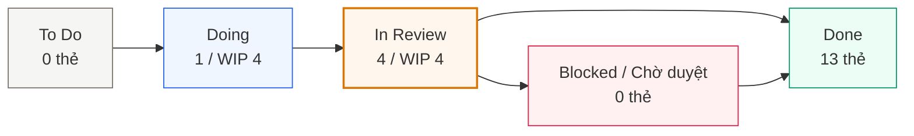

<!-- Sinh bởi kanban/render.py từ kanban/data.json. Đừng sửa tay. -->
# Bảng việc — goso

Bảng Kanban của **admatrixorg/goso**, 5 cột từ **To Do → Done**. Agent đọc bảng này đầu phiên để biết repo đang có gì và tới đâu.

- **Cập nhật:** `2026-11-27 13:50 UTC+7` · **`main`:** [`50a470a`](https://github.com/admatrixorg/goso/commit/50a470a3)
- **Nguồn dữ liệu duy nhất:** [`kanban/data.json`](data.json)
- **Bản web** (lọc owner/stream, điểm nghẽn, sáng/tối): mở [`kanban/web/index.html`](web/index.html) — mở thẳng tệp cũng chạy (dữ liệu nhúng trong `web/data.js`).
- **Bản chi tiết theo cột:** [`kanban/chi-tiet.md`](chi-tiet.md)
- **Chuyển GoClaw → Goso:** [bảng admatrix-process](https://github.com/admatrixmdp/admatrix-process)
- **Kho ý tưởng:** [`.planning/backlog.md`](../.planning/backlog.md)

## Chỉ số tổng quan

| `main` | PR đã gộp 7 ngày | PR đang mở | Doing / WIP | Điểm nghẽn |
| --- | --- | --- | --- | --- |
| [`50a470a`](https://github.com/admatrixorg/goso/commit/50a470a3) | `50` | `4` | `1/4` | **In Review 4/4** |

> **Điểm nghẽn số 1:** 4 PR đứng ở review từ đầu tháng 11, chạm WIP 4; #38 xung đột với main.

## Luồng Kanban

## Bảng Kanban

<table>
<thead>
<tr>
<th align="left" width="20%" bgcolor="#f5f5f4">📋 To Do 0</th>
<th align="left" width="20%" bgcolor="#eff6ff">🚧 Doing 1/4</th>
<th align="left" width="20%" bgcolor="#fff7ed">🔎 In Review 4/4</th>
<th align="left" width="20%" bgcolor="#fff1f2">⛔ Blocked / Chờ duyệt 0</th>
<th align="left" width="20%" bgcolor="#ecfdf5">✅ Done 13</th>
</tr>
</thead>
<tbody>
<tr valign="top">
<td valign="top" width="20%">

</td>
<td valign="top" width="20%">

<strong><a href="https://github.com/admatrixmdp/admatrix-process">CHUYEN-GOSO</a></strong> Chuyển dữ liệu GoClaw (Mac mini) sang Goso trên VPS 2 Lead · bảng riêng ở admatrix-process ➡️ Xem tiến độ từng bước trên bảng admatrix-process; không chép thẻ sang đây

</td>
<td valign="top" width="20%">

<strong><a href="https://github.com/admatrixorg/goso/pull/38">#38</a></strong> · SPEC MQG-229 ⚠️ docs: Memory v3 specs 153–169 (MQG-229) admatrixmdp · xung đột với main, đứng từ 12/11 · CONFLICTING · <code>cursor/memory-v3-specs-153-169-ff9f</code> ➡️ Rebase lên main rồi gộp (chỉ tài liệu)

<strong><a href="https://github.com/admatrixorg/goso/pull/24">#24</a></strong> ⚠️ feat(bridge): score knowledge chunks with Jev before injection admatrixmdp · đứng từ 12/11 · <code>cursor/jev-knowledge-filter-f553</code> ➡️ Chạy test bridge rồi gộp hoặc đóng

<strong><a href="https://github.com/admatrixorg/goso/pull/23">#23</a></strong> ⚠️ fix(replycheck): split SHOP FACTS from CUSTOMER WORDS (FM bugs: order-code false hold, customer voucher miss) admatrixmdp · đứng từ 02/11 · <code>fix/replycheck-customer-words</code> ➡️ Chạy test replycheck rồi gộp hoặc đóng

<strong><a href="https://github.com/admatrixorg/goso/pull/10">#10</a></strong> ⚠️ Trò chuyện: Project section above recent conversations admatrixmdp · đứng từ 12/11 · <code>cursor/chat-project-sidebar-a600</code> ➡️ Xem lại giao diện rồi gộp hoặc đóng

</td>
<td valign="top" width="20%">

</td>
<td valign="top" width="20%">

<strong>Gộp trong 7 ngày</strong>

<strong><a href="https://github.com/admatrixorg/goso/pull/139">#139</a></strong> feat(auth): cho khoá API cấp gateway chỉ đọc xem người dùng của một tenant admatrixmdp · gộp 2026-11-26 · <code>feat/system-key-read-users</code>

<strong><a href="https://github.com/admatrixorg/goso/pull/137">#137</a></strong> fix(channels): list only the request tenant channels admatrixmdp · gộp 2026-11-26 · <code>fix/channel-list-tenant-scope</code>

<strong><a href="https://github.com/admatrixorg/goso/pull/138">#138</a></strong> ci: serialize test packages when a shared Postgres is configured admatrixmdp · gộp 2026-11-26 · <code>ci/serialize-pg-tests</code>

<strong><a href="https://github.com/admatrixorg/goso/pull/136">#136</a></strong> fix(channel): polite Vietnamese voice on customer chats admatrixmdp · gộp 2026-11-24 · <code>fix/zalo-content-voice</code>

<strong><a href="https://github.com/admatrixorg/goso/pull/135">#135</a></strong> fix(zalo): keep the personal websocket alive and reply to the sender admatrixmdp · gộp 2026-11-24 · <code>fix/zalo-personal-keepalive</code>

<strong><a href="https://github.com/admatrixorg/goso/pull/134">#134</a></strong> fix(zalo): run the personal listener and answer inbound DMs admatrixmdp · gộp 2026-11-24 · <code>fix/zalo-personal-reply</code>

<strong><a href="https://github.com/admatrixorg/goso/pull/133">#133</a></strong> ci: make CircleCI the only pipeline admatrixmdp · gộp 2026-11-24 · <code>ci/disable-github-actions</code>

<strong><a href="https://github.com/admatrixorg/goso/pull/132">#132</a></strong> ci: run CircleCI on every push so the connected project actually builds admatrixmdp · gộp 2026-11-24 · <code>ci/circleci-trigger</code>

<strong><a href="https://github.com/admatrixorg/goso/pull/130">#130</a></strong> ci: add a CircleCI pipeline that mirrors the GitHub workflow admatrixmdp · gộp 2026-11-24 · <code>ci/circleci</code>

<strong><a href="https://github.com/admatrixorg/goso/pull/131">#131</a></strong> fix(channels): stop 404s on the channel detail panels that are not ported admatrixmdp · gộp 2026-11-24 · <code>fix/channel-detail-empty-panels</code>

<strong><a href="https://github.com/admatrixorg/goso/pull/129">#129</a></strong> fix(zalo): sign requests so a stored cookie set is accepted admatrixmdp · gộp 2026-11-24 · <code>fix/zalo-signed-params</code>

<strong><a href="https://github.com/admatrixorg/goso/pull/128">#128</a></strong> fix(channels): show a freshly created channel on the first page admatrixmdp · gộp 2026-11-24 · <code>fix/channel-list-order</code>

<strong><a href="https://github.com/admatrixorg/goso/pulls?q=is%3Apr+is%3Amerged+merged%3A%3E%3D2026-11-20">GOP-KHAC</a></strong> Thêm 38 PR gộp khác trong 7 ngày nhiều người

</td>
</tr>
</tbody>
</table>

Cách cập nhật bảng

1. Sửa nguồn sự thật [`kanban/data.json`](data.json) — không sửa tay README này.
   - Mở PR: thêm thẻ (`kind: "pr"`, `url` trỏ PR) vào cột `review`, hoặc `doing` nếu còn nháp.
   - Sắp gộp PR: commit cuối của chính PR đó chuyển thẻ sang `done`, ghi `status` (để main không trễ một nhịp). PR đóng không gộp: chuyển `done`, ghi lý do. Kẹt chờ PO: cột `blocked`, `next_step` ghi đang chờ gì.
   - Bắt đầu việc chưa có PR: thẻ cột `doing` (`kind: "issue"`), `head` là nhánh.
2. Chạy `python3 kanban/render.py` để sinh lại `kanban/README.md`, `kanban/chi-tiet.md`, `kanban/web/data.js`, `kanban/web/data.json`.
3. Commit cùng PR đang làm (không mở PR riêng chỉ để sửa bảng).
4. `python3 kanban/render.py --tom-tat` liệt kê PR mở chưa có thẻ và thẻ trỏ PR đã đóng.

